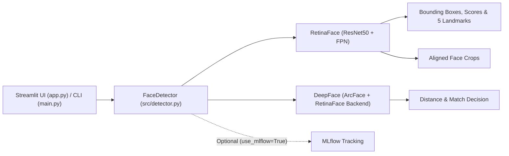

<div align="center">

# RetinaFace Detection & Verification

**Multi-face detection, 5-point landmark localization, and 1-to-many identity verification built with RetinaFace, DeepFace (ArcFace), OpenCV, and Streamlit.**

[](https://imdatascientistsachin-ratina-face.hf.space)
[](https://github.com/ImdataScientistSachin/RetinaFace-Detection/actions/workflows/ci.yml)

[](https://www.python.org/)
[](https://www.tensorflow.org/)
[](https://opencv.org/)
[](https://streamlit.io/)
[](https://www.docker.com/)
[](https://github.com/astral-sh/ruff)

[Live Demo](https://imdatascientistsachin-ratina-face.hf.space) · [Hugging Face Space](https://huggingface.co/spaces/ImdataScientistSachin/Ratina_face) · [Quick Start](#quick-start) · [API Reference](#python-api)

</div>

---

## Overview

**RetinaFace Detection & Verification** packages face detection, facial landmark localization, aligned portrait extraction, and biometric identity verification behind a clean Python API (`FaceDetector`), an interactive Streamlit web UI, a CLI tool, and a Dockerized Hugging Face Spaces deployment.

### Key Capabilities

- **Dense Face Detection & 5-Point Landmarks:** Uses `retina-face` (`ResNet50` + Feature Pyramid Network) to localize bounding boxes, confidence scores, and 5 facial landmarks (`right_eye`, `left_eye`, `nose`, `mouth_right`, `mouth_left`).
- **Aligned Portrait Extraction:** Crops and aligns detected faces via `RetinaFace.extract_faces` using configurable confidence thresholds.
- **1-to-Many Identity Verification:** Compares a reference face against multiple test images using `deepface` (`ArcFace` by default, or any supported DeepFace model such as `Facenet`).
- **Optional MLflow Telemetry:** When `use_mlflow=True`, logs `face_count`, `latency_ms`, `avg_confidence`, `verified`, and `distance` to the `RetinaFace_Inference_Monitoring` experiment.
- **Containerized Delivery:** Non-root Docker image configured for Hugging Face Spaces (`port 7860`) with automated lint/test CI and Hub sync workflows.

---

## Architecture



| Component | Path | Responsibility |
| :--- | :--- | :--- |
| Core Wrapper | [`src/detector.py`](src/detector.py) | `FaceDetector` class for detection, alignment, verification, visualization, and optional MLflow logging |
| Web UI | [`app.py`](app.py) | Streamlit multi-page app for batch detection, portrait extraction, and 1-to-many verification |
| CLI | [`main.py`](main.py) | `detect` and `verify` subcommands for single images and directories |
| Unit Tests | [`tests/test_detector.py`](tests/test_detector.py) | Pytest suite covering initialization, array/path detection, extraction, verification, error wrapping, and drawing |
| Container | [`Dockerfile`](Dockerfile) | `python:3.10-slim` runtime with headless OpenCV libraries and non-root `appuser` on port `7860` |
| CI / CD | [`.github/workflows/`](.github/workflows) | `ci.yml` (Ruff + Pytest) and `hf_sync.yml` (Hugging Face Space deployment) |

---

## Quick Start

### 1. Local Python Setup

```bash
git clone https://github.com/ImdataScientistSachin/RetinaFace-Detection.git
cd RetinaFace-Detection
python -m pip install --upgrade pip
pip install -r requirements.txt
```

Launch the Streamlit web app:

```bash
streamlit run app.py
```

### 2. Docker

```bash
docker build -t retinaface-detection .
docker run -p 7860:7860 retinaface-detection
```

Open `http://localhost:7860` in your browser.

> **Note:** On first inference, `retina-face` and `deepface` automatically download their pretrained model weights into `$DEEPFACE_HOME/.deepface/weights` (defaulting to `~/.deepface/weights`).

---

## Usage

### Python API

```python
import cv2
from src.detector import FaceDetector

detector = FaceDetector(threshold=0.9, verification_model="ArcFace", use_mlflow=False)

# Detect faces and draw bounding boxes + 5-point landmarks
image = cv2.imread("sample.jpg")
detections = detector.detect(image)
annotated = detector.draw_results(image, detections)

# Extract aligned face crops
faces = detector.extract_faces(image, align=True)

# Verify identity between two images
result = detector.verify("reference.jpg", "candidate.jpg")
print(result["verified"], result["distance"], result["threshold"])
```

<details>
<summary><strong>FaceDetector Method Reference</strong></summary>

| Method | Signature | Description |
| :--- | :--- | :--- |
| `__init__` | `(threshold=0.9, verification_model="ArcFace", use_mlflow=False)` | Configures detection threshold, verification backbone, and optional MLflow experiment logging |
| `detect` | `(image_input: str \| np.ndarray) -> dict[str, Any]` | Detects faces and returns `{face_id: {score, facial_area, landmarks}}` or `{}` if none found |
| `extract_faces` | `(image_input: str \| np.ndarray, align: bool = True) -> list[np.ndarray]` | Returns aligned or raw face crops at `self.threshold` |
| `verify` | `(img1_path: str, img2_path: str) -> dict[str, Any]` | Runs `DeepFace.verify` with `detector_backend="retinaface"` and `align=True` |
| `draw_results` | `(image: np.ndarray, results: dict[str, Any]) -> np.ndarray` | Static helper returning an annotated copy of `image` without mutating the input array |

</details>

### Command-Line Interface

Run face detection on a single image or a directory of `.jpg`/`.jpeg`/`.png` files:

```bash
python main.py detect --image path/to/image.jpg --output_dir output --threshold 0.9
python main.py detect --input_dir path/to/images --output_dir output
```

Run identity verification between two images:

```bash
python main.py verify path/to/reference.jpg path/to/candidate.jpg --model ArcFace
```

### Streamlit Web UI

[`app.py`](app.py) provides three views with a sidebar threshold slider (`0.1` – `1.0`):

1. **Face Detection:** Upload one or more images, inspect annotated bounding boxes and landmarks, and preview extracted portraits.
2. **Identity Verification:** Upload one reference image and multiple test images to view match status, cosine/embedding distance, relative confidence, and thumbnail previews.
3. **System Info:** Displays active stack and deployment details.

---

## Configuration

Local overrides can be placed in a gitignored `.env` file (never committed or copied into Docker images):

| Variable | Purpose | Default |
| :--- | :--- | :--- |
| `STREAMLIT_SERVER_PORT` | Streamlit HTTP server port | `7860` |
| `STREAMLIT_SERVER_ADDRESS` | Network interface to bind | `0.0.0.0` (Docker) / `localhost` |
| `DEEPFACE_HOME` | Directory where `.deepface/weights` are cached | User home (`~`) |
| `TF_ENABLE_ONEDNN_OPTS` | Toggle TensorFlow oneDNN optimizations (`0` or `1`) | TensorFlow default |
| `MLFLOW_TRACKING_URI` | Tracking store URI when `use_mlflow=True` | `./mlruns` |
| `HF_TOKEN` | Hugging Face **Write** token for CI Space sync (`hf_sync.yml` only) | GitHub Actions secret |

---

## Development & CI/CD

Install development dependencies and run lint, formatting checks, and unit tests locally:

```bash
pip install -r requirements.txt -r requirements-dev.txt
ruff check .
ruff format --check .
python -m pytest tests/ -v
```

### Automated Workflows

- **CI Pipeline ([`ci.yml`](.github/workflows/ci.yml)):** Triggered on pushes and pull requests to `main`; installs system OpenCV dependencies (`libgl1`, `libglib2.0-0`), runs `ruff check .`, and executes `pytest tests/ -v`.
- **Hugging Face Sync ([`hf_sync.yml`](.github/workflows/hf_sync.yml)):** Triggered on pushes to `main` or manual dispatch; uploads runtime files to `ImdataScientistSachin/Ratina_face` using `secrets.HF_TOKEN` while excluding `.git/`, `.github/`, `tests/`, caches, and local `.env*` files.

---

## Project Structure

```text
RetinaFace-Detection/
├── .github/workflows/
│   ├── ci.yml                  # Ruff lint and pytest CI workflow
│   └── hf_sync.yml             # Automated Hugging Face Space deployment
├── src/
│   └── detector.py             # FaceDetector wrapper
├── tests/
│   └── test_detector.py        # Unit tests for FaceDetector
├── .dockerignore               # Docker build exclusions
├── .gitignore                  # Git exclusions (caches, weights, .env, logs)
├── app.py                      # Streamlit web application
├── conftest.py                 # Pytest project root path setup
├── Dockerfile                  # Production container (non-root, port 7860)
├── main.py                     # CLI entry point
├── README.md                   # Project documentation
├── requirements-dev.txt        # Lint and test dependencies
└── requirements.txt            # Runtime dependencies
```

---

## Maintainer

**Sachin Paunikar** — [LinkedIn](https://www.linkedin.com/in/sachin-paunikar-datascientists) · [GitHub](https://github.com/ImdataScientistSachin)
